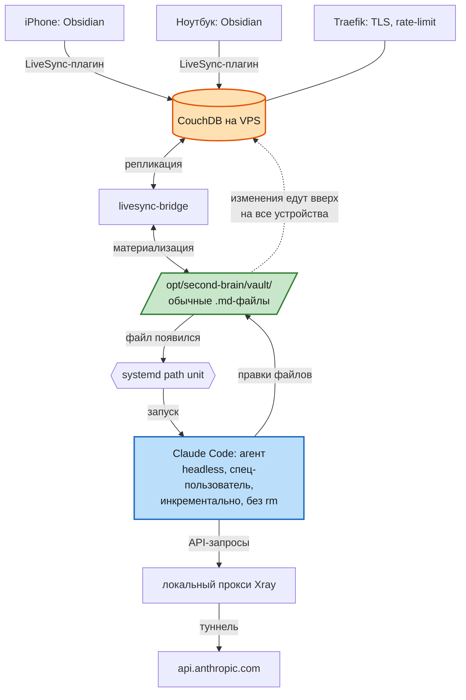

# Второй мозг: обзор архитектуры

Серия инструкций описывает, как развернуть личную систему знаний на основе ИИ: заметки Obsidian на всех устройствах и автономные ИИ-агенты на вашем сервере, которые работают с той же базой.

Если вы новичок, сначала прочитайте [00-с чего начать](00-%D1%81%20%D1%87%D0%B5%D0%B3%D0%BE%20%D0%BD%D0%B0%D1%87%D0%B0%D1%82%D1%8C.md), затем [00-как это работает простыми словами](00-%D0%BA%D0%B0%D0%BA%20%D1%8D%D1%82%D0%BE%20%D1%80%D0%B0%D0%B1%D0%BE%D1%82%D0%B0%D0%B5%D1%82%20%D0%BF%D1%80%D0%BE%D1%81%D1%82%D1%8B%D0%BC%D0%B8%20%D1%81%D0%BB%D0%BE%D0%B2%D0%B0%D0%BC%D0%B8.md) и держите рядом [00-глоссарий](00-%D0%B3%D0%BB%D0%BE%D1%81%D1%81%D0%B0%D1%80%D0%B8%D0%B9.md).

## Что получается в итоге

Заметка, созданная на телефоне, через секунды лежит файлом на сервере. Агент разбирает ее по структуре, результат сам появляется на всех устройствах. Управление агентами - тоже заметками.

## Схема потоков данных

Нижняя ветка (прокси Xray) нужна для серверов в странах с гео-ограничениями API. Из стран без ограничений сервер обращается к API напрямую.

## Компоненты и роли

| Компонент | Роль | Инструкция |
|---|---|---|
| VPS Ubuntu 22.04 | хост всего | [01-подготовка vps и безопасность](01-%D0%BF%D0%BE%D0%B4%D0%B3%D0%BE%D1%82%D0%BE%D0%B2%D0%BA%D0%B0%20vps%20%D0%B8%20%D0%B1%D0%B5%D0%B7%D0%BE%D0%BF%D0%B0%D1%81%D0%BD%D0%BE%D1%81%D1%82%D1%8C.md) |
| Docker и Traefik | изоляция сервисов, TLS | [02-docker и traefik](02-docker%20%D0%B8%20traefik.md) |
| CouchDB и LiveSync | синхронизация устройств | [03-синхронизация obsidian](03-%D1%81%D0%B8%D0%BD%D1%85%D1%80%D0%BE%D0%BD%D0%B8%D0%B7%D0%B0%D1%86%D0%B8%D1%8F%20obsidian.md) |
| livesync-bridge | база и файлы в обе стороны | [04-мост в файлы (livesync-bridge)](04-%D0%BC%D0%BE%D1%81%D1%82%20%D0%B2%20%D1%84%D0%B0%D0%B9%D0%BB%D1%8B%20%28livesync-bridge%29.md) |
| Claude Code | исполнитель-агент | [05-claude code на сервере](05-claude%20code%20%D0%BD%D0%B0%20%D1%81%D0%B5%D1%80%D0%B2%D0%B5%D1%80%D0%B5.md) |
| Прокси Xray | канал к API из стран с гео-ограничениями | [05-claude code на сервере](05-claude%20code%20%D0%BD%D0%B0%20%D1%81%D0%B5%D1%80%D0%B2%D0%B5%D1%80%D0%B5.md) |
| systemd и cron | события и страховка | [06-агенты и события](06-%D0%B0%D0%B3%D0%B5%D0%BD%D1%82%D1%8B%20%D0%B8%20%D1%81%D0%BE%D0%B1%D1%8B%D1%82%D0%B8%D1%8F.md) |
| sync-watchdog | догоняет файлы, о которых не узнал мост | [08-сторож синхронизации](08-%D1%81%D1%82%D0%BE%D1%80%D0%BE%D0%B6%20%D1%81%D0%B8%D0%BD%D1%85%D1%80%D0%BE%D0%BD%D0%B8%D0%B7%D0%B0%D1%86%D0%B8%D0%B8.md) |
| Ручной запуск | отладка и проверки | [09-запуск claude code вручную](09-%D0%B7%D0%B0%D0%BF%D1%83%D1%81%D0%BA%20claude%20code%20%D0%B2%D1%80%D1%83%D1%87%D0%BD%D1%83%D1%8E.md) |
| Новый агент | пошаговое добавление агента к развернутой системе | [10-как завести нового агента](10-%D0%BA%D0%B0%D0%BA%20%D0%B7%D0%B0%D0%B2%D0%B5%D1%81%D1%82%D0%B8%20%D0%BD%D0%BE%D0%B2%D0%BE%D0%B3%D0%BE%20%D0%B0%D0%B3%D0%B5%D0%BD%D1%82%D0%B0.md) |
| Claude Desktop и Obsidian | MCP-мост для приложения на компьютере и Cowork (отдельная ветка, не сервер) | [11-obsidian mcp для claude desktop](11-obsidian%20mcp%20%D0%B4%D0%BB%D1%8F%20claude%20desktop.md) |
| Правила агентов | CLAUDE.md, скиллы, карточки агентов: очередь, предложения, отчеты | [12-скиллы и методист](12-%D1%81%D0%BA%D0%B8%D0%BB%D0%BB%D1%8B%20%D0%B8%20%D0%BC%D0%B5%D1%82%D0%BE%D0%B4%D0%B8%D1%81%D1%82.md) |
| Помощник по серверу | инструкция и документы для проекта Claude, который помогает администрировать систему | [13-инструкция для помощника по серверу](13-%D0%B8%D0%BD%D1%81%D1%82%D1%80%D1%83%D0%BA%D1%86%D0%B8%D1%8F%20%D0%B4%D0%BB%D1%8F%20%D0%BF%D0%BE%D0%BC%D0%BE%D1%89%D0%BD%D0%B8%D0%BA%D0%B0%20%D0%BF%D0%BE%20%D1%81%D0%B5%D1%80%D0%B2%D0%B5%D1%80%D1%83.md) |
| Стартовый набор | устав CLAUDE.md, 18 скиллов и карточки пяти агентов как шаблоны | [14-стартовый набор](14-%D1%81%D1%82%D0%B0%D1%80%D1%82%D0%BE%D0%B2%D1%8B%D0%B9%20%D0%BD%D0%B0%D0%B1%D0%BE%D1%80.md) |
| Резервные копии и обслуживание | копия вне сервера, восстановление, регулярные проверки | [15-резервные копии и обслуживание](15-%D1%80%D0%B5%D0%B7%D0%B5%D1%80%D0%B2%D0%BD%D1%8B%D0%B5%20%D0%BA%D0%BE%D0%BF%D0%B8%D0%B8%20%D0%B8%20%D0%BE%D0%B1%D1%81%D0%BB%D1%83%D0%B6%D0%B8%D0%B2%D0%B0%D0%BD%D0%B8%D0%B5.md) |

## Ключевые архитектурные решения

1. **Хранилище как файлы на сервере.** Агентам нужны обычные файлы, поэтому E2EE синхронизации отключен, а защиту обеспечивают TLS, аутентификация и файрвол.
2. **CouchDB, а не Syncthing.** Это единственный путь с полноценным iOS. Цена: нужен мост, потому что CouchDB хранит кусочки документов, а не файлы.
3. **Агенты без права удаления.** Список инструментов без rm, перемещение в архив вместо стирания. Ошибка агента обратима.
4. **События вместо расписания.** Path unit будит агента при появлении файла, cron служит страховочной сверкой. Холостой запуск должен быть бесплатным: проверка наличия работы стоит до вызова claude в скрипте. Иначе каждое срабатывание триггера, в том числе от чужих заданий, - платный вызов. См. [урок - стоимость работы агентов](../lessons/%D1%83%D1%80%D0%BE%D0%BA%20-%20%D1%81%D1%82%D0%BE%D0%B8%D0%BC%D0%BE%D1%81%D1%82%D1%8C%20%D1%80%D0%B0%D0%B1%D0%BE%D1%82%D1%8B%20%D0%B0%D0%B3%D0%B5%D0%BD%D1%82%D0%BE%D0%B2.md).
5. **Управление агентами через заметки.** Карточки и задания лежат в хранилище: поведение агента меняется правкой заметки с любого устройства.
6. **Единицу работы агента задают правила, а не скрипт.** Скрипт запуска передает агенту только карточку, поэтому очередь режет скилл agent-run: задания по одному, у каждого свой отчет и свое предложение, неясность блокирует только свое задание (статус «ждет решения»). См. [урок - единица работы агента](../lessons/%D1%83%D1%80%D0%BE%D0%BA%20-%20%D0%B5%D0%B4%D0%B8%D0%BD%D0%B8%D1%86%D0%B0%20%D1%80%D0%B0%D0%B1%D0%BE%D1%82%D1%8B%20%D0%B0%D0%B3%D0%B5%D0%BD%D1%82%D0%B0.md).
7. **Три вида отчетов, у каждого одно место и одна форма имени:** отчет по заданию, отчет по исполненному предложению, отчет фонового прогона. См. [урок - отчеты агентов](../lessons/%D1%83%D1%80%D0%BE%D0%BA%20-%20%D0%BE%D1%82%D1%87%D0%B5%D1%82%D1%8B%20%D0%B0%D0%B3%D0%B5%D0%BD%D1%82%D0%BE%D0%B2.md).
8. **Решение человека оформлено заранее.** Предложение агента: одна проблема, один файл, два пустых раздела для ответа («Решение пользователя» и «Комментарий пользователя»). Отклонение с комментарием приводит к новому предложению. См. [урок - предложения агентов](../lessons/%D1%83%D1%80%D0%BE%D0%BA%20-%20%D0%BF%D1%80%D0%B5%D0%B4%D0%BB%D0%BE%D0%B6%D0%B5%D0%BD%D0%B8%D1%8F%20%D0%B0%D0%B3%D0%B5%D0%BD%D1%82%D0%BE%D0%B2.md) и скилл proposal-card в [12-скиллы и методист](12-%D1%81%D0%BA%D0%B8%D0%BB%D0%BB%D1%8B%20%D0%B8%20%D0%BC%D0%B5%D1%82%D0%BE%D0%B4%D0%B8%D1%81%D1%82.md).

## Порядок развертывания

Выполняйте инструкции строго по номерам 01-06: каждый слой опирается на предыдущий. Инструкции 08 и 09 вспомогательные, их выполняют после основного контура. Инструкции 10-12 нужны, когда вы добавляете агентов, подключаете Claude Desktop или меняете правила агентов. Уроки собраны в [07-уроки проекта](07-%D1%83%D1%80%D0%BE%D0%BA%D0%B8%20%D0%BF%D1%80%D0%BE%D0%B5%D0%BA%D1%82%D0%B0.md).

## Требования

- VPS: 4 vCore, 6 GB RAM и больше, Ubuntu 22.04
- Домен с возможностью создавать поддомены
- Obsidian на устройствах (подписка Obsidian Sync не нужна)
- Ключ API Anthropic (оплата по токенам) для агентов
- Модель задается явно флагом --model в каждом скрипте запуска: по умолчанию используется самая дорогая
